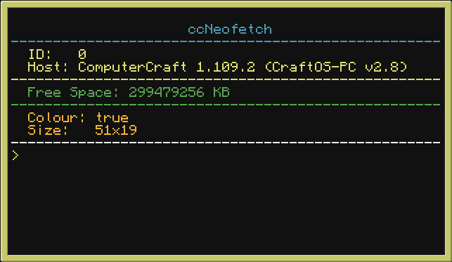

# CC GLib

Most of my computer craft stuff packaged up in a way useful to me, and occasionally you (I hope)

```bash
carl repo add https://raw.githubusercontent.com/ghostdevv/cc-glib/refs/heads/main/carl-repo.json
```

## Core Commands

### `neofetch`

The `neofetch` command is inspired by the popular [bash based neofetch tool](https://github.com/dylanaraps/neofetch).

```bash
$ neofetch
```



### `cat`

The `cat` command can be used to read the contents of a file, it will also display some helpful information such as it's line count and size.

```bash
$ cat <file>
```

### `touch`

Create empty file(s) quickly with touch.

```bash
$ touch <file...>
```

## Turtle Commands

These commands are only installed on turtles.

### `fuel`

The `fuel` command simply lists out the current fuel and fuel limit.

```bash
$ fuel
Fuel Level: 11157/100000
```

### `mine`

The `mine` command ([`ghostdevv/mining-turtle`](https://github.com/ghostdevv/mining-turtle)) is used to mine an area the user defines.

The turtle must be placed in the bottom left corner facing the direction you want to mine.

```bash
$ mine <width> <height> <depth>
```

## Monitors

### `map`

Used to show a map, or really any image, on a monitor

```bash
$ map [map.qoi]
```
